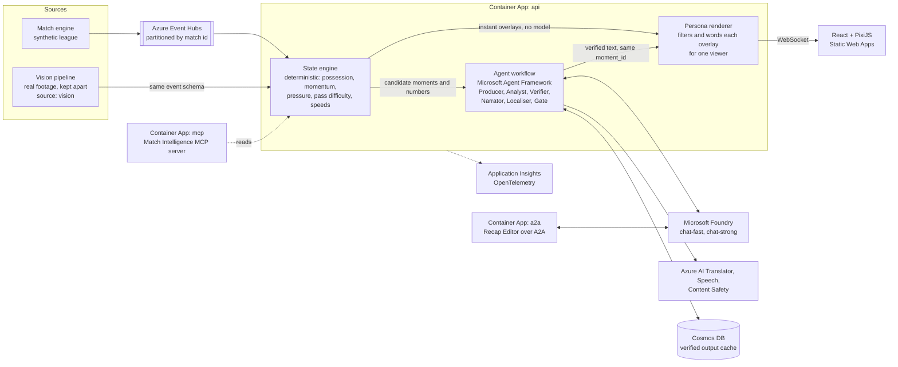
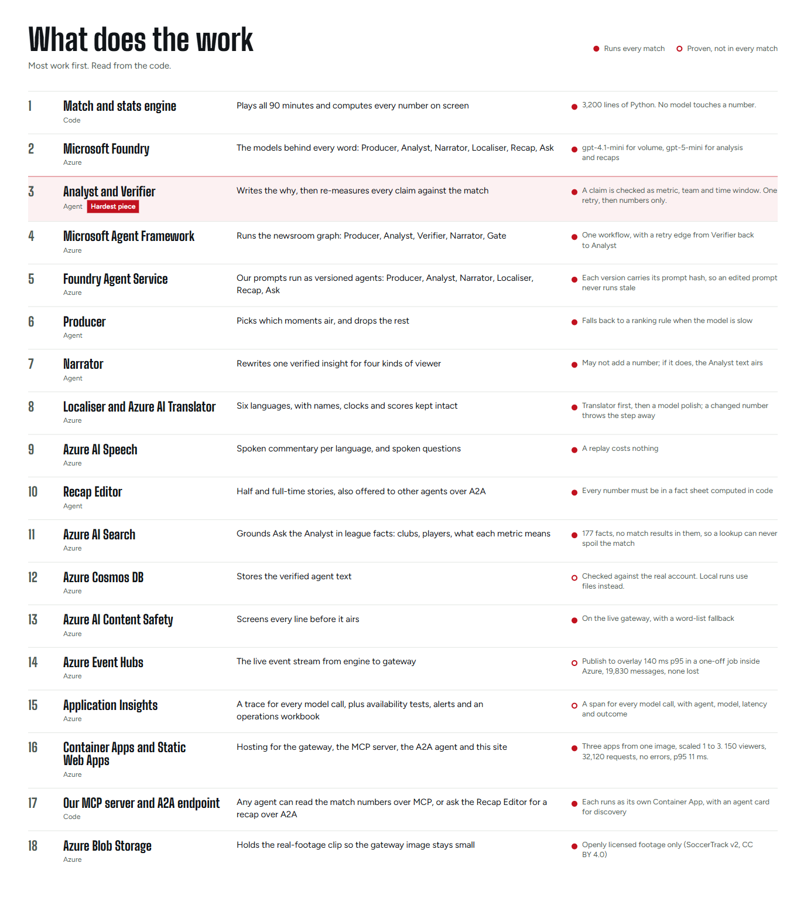
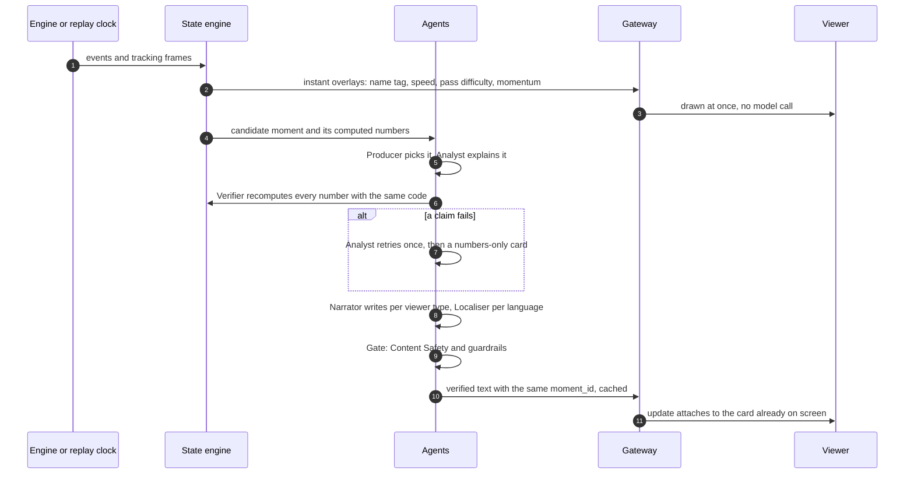
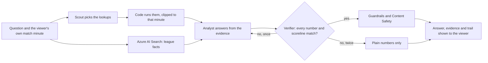

# Novessa Pitchside

**Same match. Your story.**

**Live demo:** https://ashy-pebble-0f5b51c1e.5.azurestaticapps.net (no login, runs on Azure)

**Demo video (under 2 minutes):** https://www.youtube.com/watch?v=1SrFywZFIYE

Everyone watching a match gets the same broadcast. The analyst who wants pressing numbers and the mate who just wants to know why their team suddenly looks rattled see exactly the same thing. Novessa Pitchside gives each of them their own version of the game, live.

A match engine plays a full 90 minutes of football in an invented league. A stats layer turns it into momentum, pressure, control and chaos, pass difficulty, speeds and distances, in code. A team of agents on Microsoft Foundry decides which moments matter, explains why in football terms, proves every number against the stats layer before it airs, then writes it up for each viewer: their persona, their language, their club or player. The output is a timed overlay protocol, so any graphics engine could draw it.

The part we care most about is trust. A model never computes a number here, and nothing it writes reaches the screen until the Verifier has recomputed every figure. When a claim fails, the viewer gets the plain numbers instead of a nice-sounding guess. You can kill any agent mid-match from the Control Room and watch the broadcast carry on.

Built for the "Inside the Game" developer hackathon. All match data is synthetic. No real clubs, players or marks anywhere.


The same match for two viewers, second for second. The analyst gets the numbers in English. The first-timer gets the story in Spanish, with an arrow showing which way the ball is going:


The agents at work. Every moment passes the Producer, Analyst, Verifier and Safety gate, and the chaos switch on each plate shows the system recovering:


## Try it

**Fastest:** open the live demo above. Start with Watch, then Side by side, then Control room. Press `/` on the broadcast to ask the analyst a question.

**Accessibility modes:** on Watch, open "Watching as" and pick **Audio-described**, then press **Commentary** to turn the voice on. You get spoken commentary with captions, written to say who and where. **First match** gives plain words and an arrow for the way play is going, **Just one number** keeps a single stat on screen, and the same panel switches language (try العربية for right to left). `/` opens Ask, typed or spoken. Turn on reduced motion in your system settings and the entrances become plain fades.

**On your machine,** in about a minute. You need Git, Python 3.12 with [`uv`](https://docs.astral.sh/uv/), and Node 22 or newer. The first install downloads about 650 MB. No `.env` file and no Azure account are needed.

```bash
git clone https://github.com/vishit18/Novessa-Pitchside.git
cd Novessa-Pitchside

# terminal 1: the gateway
uv sync
uv run uvicorn backend.app.main:app --port 8000

# terminal 2: the app
cd frontend
npm install
npm run dev
```

The same commands work in PowerShell and in bash.

Open http://localhost:5173. The home page says what this is, shows one goal told three ways, and links to every screen. Every page has the same menu.

With no model endpoint set, the agents stay off by themselves: you get the pitch, the instant overlays, the stats and the recap numbers. Ask the analyst and the written recaps need the agents (below), so Ask answers "The analyst is off right now" until then. To force the agents off when an endpoint is set, start the gateway with `AGENTS=off` (bash) or `$env:AGENTS='off'` first (PowerShell).

### With the agents on

The agents, Translator, Speech and Content Safety all live on one Foundry resource and sign in with Entra ID, so there are no keys to paste. You need the Azure CLI, signed in as someone with the **Cognitive Services User** role on that resource (see [`docs/02_AZURE_SETUP.md`](docs/02_AZURE_SETUP.md)).

1. Sign in: `az login`
2. Copy `.env.example` to `.env` and set these five, all pointing at the same resource:
   ```bash
   FOUNDRY_OPENAI_ENDPOINT=https://<resource>.cognitiveservices.azure.com/
   TRANSLATOR_ENDPOINT=https://<resource>.cognitiveservices.azure.com/
   TRANSLATOR_REGION=<region, e.g. swedencentral>
   SPEECH_REGION=<same region>
   CONTENT_SAFETY_ENDPOINT=https://<resource>.cognitiveservices.azure.com/
   ```
3. Start the gateway with that file (`PRELOAD=1` builds the three demo matches at start-up, so the first page loads fast):
   ```bash
   PRELOAD=1 uv run --env-file .env uvicorn backend.app.main:app --port 8000
   ```
   In PowerShell: `$env:PRELOAD=1; uv run --env-file .env uvicorn backend.app.main:app --port 8000`
4. Start the app as above (`cd frontend`, `npm run dev`) and open http://localhost:5173.

Check it is on: http://localhost:8000/agents/health should say `"enabled": true`, and http://localhost:8000/speech/health `"transcribe": true` (that is what shows the mic in Ask the analyst).

Places worth a look:

| Screen | Link | What to try |
|---|---|---|
| Live | `/watch?match=derby_01&live=1` | The same broadcast, fed straight off Event Hubs as the engine publishes it. Live means live: it starts at kick-off at real speed with nothing to scrub, so you wait for the next minute like you would on TV. To jump around, follow "Watch the replay to scrub" under the pitch, or use the Broadcast row below. |
| Broadcast | `/watch?match=derby_01&speed=4` | Overlays land instantly, the "why" text a moment later. Move the mouse for the timeline: drag to any minute, skip 30 s, change speed, or switch on "Key moments" to mark the goals and cards (it shows the result, so it is off by default). The menu in the corner reaches every other screen. |
| Split | `/split?match=derby_01` | Two viewers on the same second of the same match: an analyst in English and a first-timer in Spanish. Starts just before the first goal. The pitch itself differs: the analyst sees who is pressing the ball and the two simplest passes, the first-timer a big arrow showing which way the team on the ball is going and "Kestrel Bay FC tiene el balón". Change either viewer with "Viewing as". Under each pane is what that viewer has been told so far. One timeline drives both. |
| Ask the analyst | press `/` on the broadcast, or Ask on the phone view | Ask anything about the match in any of the six languages, typed or out loud (hold the mic, speak, let go). A Scout agent picks the lookups, code runs them up to your minute only (no spoilers), Azure AI Search adds league facts, the Analyst answers, the Verifier checks every number. Open "How this was worked out" to see each number used. |
| Companion | `/companion?match=derby_01&speed=10` | The phone view, with its own timeline. Tap "What did I miss?" for a spoiler-safe catch-up. |
| Control Room | `/control?match=derby_01` | The agents at work, the Verifier rejecting a claim, and the chaos switch that kills an agent mid-match. |
| Recap | `/recap?match=derby_01&kind=full_time` | Half-time and full-time recaps in six languages. |
| One number | pick "Just one number" in onboarding | Choose sprint speed, shot speed, pass difficulty or distance. The broadcast keeps that number on screen and shows only that, plus goals. |
| Real footage | `/real` | The same overlays on a real amateur match, measured from video. Full screen keeps the tracking on the picture. |
| How it's built | `/why` | Why it matters, then every Microsoft and Azure part that does the work, most work first. Also on the home page under Try it. |

## What it does

- **Synthetic league.** Eight invented clubs, 144 players, and a match engine with passes, carries, shots with xG, fouls, cards, penalties, corners, offsides, substitutions, fatigue and storylines that build over a match. Three demo matches ship in `data/matches/`, and `scripts/export_dataset.py` writes 200 matches as Parquet. See [`data/README.md`](data/README.md).
- **Deterministic stats.** Possession, momentum, pressure, control and chaos, rhythm, an explainable pass difficulty score, sprint speeds and distances. All of it is computed in code. No language model ever computes a number.
- **Instant overlays.** Name tags, speed bursts, pass difficulty, shot speed, cards, offsides and milestones come straight from the stats layer, with no model call.
- **Agents.** Nine agents and a safety gate, described below. Six of them write with a language model, Voice speaks with Azure AI Speech, and the Verifier and Story Keeper are plain code. Every number is checked by the Verifier, and a story check makes sure the right club and the right minute are named. They add the explanation, the commentary, the translation, the voice, the recap and answers to viewers' questions.
- **Personas.** Analyst, casual, first match and audio-described, and they change the picture as well as the words: pressing halos, passing options and evidence chips for the analyst; an arrow for the way play is going, no shirt numbers and short lines for a first-timer; a bigger ball for audio-described. Favourite club (a goal against your side is told more quietly), favourite player (the camera follows them, with a heatmap of where they have been), or a single metric. Six languages everywhere: English, Spanish, French, Arabic (right to left), Hindi and Portuguese. Agent text, recaps, voice, the instant overlays and the interface itself.
- **Real footage.** A vision pipeline reads a real, openly licensed amateur match, tags players, follows the ball and measures speeds, then scores itself against the dataset's own labels.

## The agents

| Agent | Job |
|---|---|
| Producer | Decides which candidate moments go on screen and how |
| Tactical Analyst | Explains why a moment matters, in football terms, from the computed numbers |
| Verifier | Recomputes every claim through the same stats code. A claim that fails goes back once, then falls back to numbers only |
| Narrator | Writes the live commentary line for each persona |
| Story Keeper | Tracks the running storylines of the match |
| Localiser | Translates with Azure AI Translator, then a model polishes it. Numbers and names are protected |
| Voice | Turns the line into speech with Azure AI Speech |
| Recap Editor | Writes half-time and full-time recaps, reachable over A2A on its own Container App |
| Ask the Analyst | A Scout picks which lookups to run, code runs them clipped to the viewer's own minute so nothing is spoiled, the Analyst answers, the Verifier checks every number and every scoreline. Typed or spoken |

Everything an agent says passes a QA step with Azure AI Content Safety before it airs, then guardrails strip links, markup and anything that reads back the system prompt. If an agent is slow, wrong or switched off, the picture is never held up: the instant overlay is already on screen and the text attaches later. The chaos switch in the Control Room shows this live.

We attacked Ask the Analyst with a fully hijacked model (prompt injection, spoilers, links, markup, prompt extraction, harmful text, off-topic). With the guardrails on, all 14 attacks were held, and the guarantee comes from code, not from the model behaving. The run is in CI on every agent change: [`docs/REDTEAM.md`](docs/REDTEAM.md).

## How it is built



The path through Event Hubs is the live one: the engine publishes, the gateway consumes, and `/watch?live=1` shows it. The broadcast you open by default is a replay, so anyone can scrub and seek: it reads the same events from a timeline the same state engine prepared in advance. Both paths produce identical overlays, and a test checks it. The numbers always come from the state engine. The agents only explain them.

Every part that does the work, most work first (the live version is on `/why`):



| Microsoft technology | Where it is used |
|---|---|
| Microsoft Foundry | Two chat models: a small one for the high-volume agents (Producer, Narrator, Localiser, Scout), a reasoning one for the Analyst, Ask and recaps. Foundry's evaluators (`azure-ai-evaluation`) score the output in `scripts/eval_single_vs_multi.py` |
| Microsoft Agent Framework | The Producer, Analyst, Verifier, Narrator and Gate workflow (`backend/agents/workflow.py`) |
| Foundry Agent Service | Our prompts are published as versioned agents (`pitchside-producer`, `pitchside-analyst` and the rest, `scripts/register_agents.py`), and the live app calls them by reference. Each version carries the hash of its prompt, so a prompt edited without re-publishing is never called; that agent goes straight to the model instead (`backend/agents/foundry_agents.py`). The Scout stays on direct calls, where its output is more reliable |
| Azure AI Search | Grounds Ask the Analyst in 177 league facts: clubs, squads, players and what each metric means (`backend/agents/knowledge.py`, `scripts/index_knowledge.py`). Keyless, free tier. The index holds no match results, so it cannot spoil a match |
| Azure AI Translator, Speech, Content Safety | Localiser, Voice and the QA gate, all on the Foundry resource |
| Azure Event Hubs | The live feed: engine to hub to gateway to viewer, for `/watch?live=1` (`backend/bus/`, `backend/app/live.py`). Publish to overlay was 140 ms p95 inside Azure at 4x, 19,830 messages, none lost (`docs/LOAD_TEST.md`). Replays read the prepared timeline |
| Azure Cosmos DB | Verified agent output per match, moment, persona and language |
| Azure Container Apps and Container Registry | Three apps from one image: the gateway and agents (`api`), our Match Intelligence MCP server (`mcp`) and the Recap Editor as its own A2A agent (`a2a`), plus a manual job that prepares the demo matches. One API replica stays warm (up to three under load), and so do the MCP server and the A2A agent, so nothing a judge calls starts cold. The prep job runs only when started |
| Azure Static Web Apps | The frontend, built against the live gateway |
| Azure Blob Storage | The real-footage clip. The gateway redirects to it, so the image stays small and the video is seekable |
| Azure Monitor | Application Insights and OpenTelemetry (a span on every model call: agent, model, latency, outcome), availability tests from three regions, alerts and an operations workbook |
| Azure Load Testing | 150 viewers against the live API, 32,120 requests, 0 errors ([`docs/LOAD_TEST.md`](docs/LOAD_TEST.md)) |
| Managed identity and Key Vault | Keyless access between services |
| Bicep and the Azure Developer CLI | Every resource is code (`infra/`, `azure.yaml`) |
| Azure MCP server | Used while building, to inspect and manage the resources |
| Our own MCP server and A2A endpoint | `backend/mcp_server/`, `backend/a2a/`. The match intelligence is a tool any outside agent can call, and the recap agent can be called by any other agent. Our own agents call the same stats code directly in Python, not over MCP |
| GitHub Actions and the GitHub CLI | CI (lint, types, tests, e2e and the red team) and the repo |

Decisions and their costs are in [`docs/adr/`](docs/adr/README.md). A plain-language guide to each service is in [`docs/AZURE_SERVICES.md`](docs/AZURE_SERVICES.md).

## How data flows

Four paths carry data through the system. Each says what moves, what carries it and what happens when a part fails.

### The feed: live and replay

The engine writes a seeded match as events (passes, shots, fouls, cards) and tracking frames (every player and the ball, many times a second). In Azure it publishes them to Event Hubs in one envelope with the publish time, partitioned by match id so a match stays in order ([ADR 0004](docs/adr/0004-event-bus-interface.md)). The gateway consumes them, runs the state engine and sends overlays down a WebSocket. Locally the same interface runs on an in-memory bus, so nothing needs Azure to run.

A replay skips the hub. It reads the same events from a timeline the state engine built in advance, which is what lets a viewer pause, scrub and change speed. A dead hub cannot stop a replay.

### One moment, start to finish



Two speeds, on purpose ([ADR 0002](docs/adr/0002-instant-overlays-and-late-text.md)). Anything that needs no language goes out straight from the state engine in code, with no model call. The explanation takes a few seconds, so it arrives later as an `update` with the same `moment_id` and attaches to the card already on screen. A slow, wrong or switched-off agent never holds the picture up.

The agents write a small set of variants per moment, one for each viewer type and language, and the gateway picks and filters per viewer. We do not run an agent pipeline per viewer, which is why a replay of a prepared match costs nothing. The cache key is match seed, moment, viewer type and language ([ADR 0009](docs/adr/0009-cosmos-cache-over-files.md)). Cosmos DB sits behind a local file layer, so a slow database never holds up a broadcast.

### Ask the analyst



The clip to the viewer's minute is code, not a prompt. Nothing after that minute is ever looked up, whatever the Scout asks for, so a question cannot spoil the match. The league facts from Azure AI Search are static (who a player is, what a metric means) and hold no results.

### Real footage

A real clip goes through RT-DETR for players and the ball and ByteTrack for tracking, and comes out as events in the same schema, tagged `source: "vision"`. From there the state engine and overlays are the same code as for the synthetic matches. It is shown only on the real-footage screen, with the dataset credit, and it never feeds the synthetic engine ([ADR 0005](docs/adr/0005-real-footage-kept-apart.md)).

### What is stored, and where

| Data | Where | Notes |
|---|---|---|
| Match events and tracking frames | Generated by the engine. Three demo matches ship as files in `data/matches/` | Synthetic only. No real league data |
| Verified agent text | Cosmos DB, with a local file layer in front | Keyed by match seed, moment, viewer type and language. Holds no viewer data |
| Viewer choices (viewer type, language, club, player) | The viewer's browser (`localStorage`) | Sent as query parameters when the socket opens so the gateway can filter. A random id per browser. No account, no email |
| Model call traces | Application Insights | A span per call with the agent, model, latency and outcome. The prompt and the answer are not attached to it (`backend/agents/llm.py`) |
| Real-footage clip | Blob Storage, anonymous read | Openly licensed, university marks removed. Labels and scores are small JSON files in `data/real/` |

## Why these Azure services

Most of these choices are written up in [`docs/adr/`](docs/adr/README.md). This is the short version: what we picked, what else we looked at, and why.

| Job | We picked | We looked at | Why |
|---|---|---|---|
| Models and agents | Microsoft Foundry and Microsoft Agent Framework | Calling a model API directly, other agent libraries | One resource holds the models, Translator, Speech and Content Safety, so there is one endpoint and one set of role assignments ([ADR 0006](docs/adr/0006-one-foundry-resource.md)). Foundry also gives us evaluators. Agent Framework runs the newsroom workflow, and the A2A SDK puts our Recap Editor on its own endpoint. Each service has a fallback: English text, text without speech, a local content check |
| Live feed | Event Hubs | Service Bus, Web PubSub or SignalR, a queue in the app | A match is an ordered stream, and Event Hubs keeps order per partition (we partition by match id). The consumer starts at the latest position, which is right for a live feed. Service Bus is built for queues with per-message settlement, which we do not need. Web PubSub and SignalR push to browsers, but our gateway has to filter and word every overlay for each viewer first |
| Compute | Container Apps | Functions, App Service, AKS | The gateway holds long-lived WebSockets, and one image runs three processes (`api`, `mcp`, `a2a`). Container Apps scales each on its own. Functions does not hold long-lived sockets well, and AKS is more than three small services need. One replica of each app stays warm, so nothing a judge calls starts cold |
| Cache | Cosmos DB, behind a local file layer | Files only, Postgres, Redis | The data is JSON keyed by a tuple, the free tier is enough, and the local layer means a slow database never stalls a broadcast ([ADR 0009](docs/adr/0009-cosmos-cache-over-files.md)) |
| Safety | Azure AI Content Safety, plus our own guardrails | Our own word list alone | A managed classifier catches harm a word list will not. The guardrails in code (`backend/agents/guardrails.py`) strip links, markup and anything reading back the prompt, because those carry no numbers for the Verifier to catch |
| Identity | Entra ID and managed identity, no keys | Keys in settings | The repo is public, so there is no key to leak or rotate ([ADR 0003](docs/adr/0003-keyless-entra-auth.md)) |
| Frontend hosting | Static Web Apps | Blob static site, Front Door | Free, and `azd deploy web` ships it |
| Observability | Application Insights with OpenTelemetry | Our own metrics stack | A span on every model call, availability tests from three regions, alerts and a workbook, all in one place |
| Infrastructure | Bicep and the Azure Developer CLI | Terraform, clicking in the portal | Every resource is code, and `azd` builds, pushes and deploys the apps and the site in one command |

## Responsible AI

We built this around one worry: a live broadcast puts a model's words on screen before anyone can check them. This section follows Microsoft's six Responsible AI principles. Each one says what we did and what we measured, and the last part names the few limits we know about. Accessibility has its own section straight after, because it is more than one principle's worth of work.

| Principle | What we did | Where to see it |
|---|---|---|
| Fairness | Invented data checked against real ranges; a viewer's choices change emphasis, never the facts | [`docs/CALIBRATION.md`](docs/CALIBRATION.md) |
| Reliability and safety | Every number recomputed before it airs; **14 of 14** red-team attacks held; Content Safety on every line; the broadcast carries on if an agent is down | [`docs/REDTEAM.md`](docs/REDTEAM.md), [`docs/EVALUATION.md`](docs/EVALUATION.md) |
| Privacy and security | No personal data; no keys in the repo or the services; public endpoints rate limited | [ADR 0003](docs/adr/0003-keyless-entra-auth.md) |
| Inclusiveness | Six languages, four viewer types, an audio-described mode | [Accessibility](#accessibility-and-inclusive-design) |
| Transparency | Every line can show the numbers behind it, and says when its wording could not be checked | "How this was worked out" in the app |
| Accountability | Every model call traced; every rejected claim logged; decisions written down | Control Room, Application Insights, `docs/adr/` |

### Fairness

- **The data is invented.** There is no real player's data in the system, so there is no real person for a model to describe. Real footage is a separate, openly licensed dataset kept inside `vision/`.
- **Calibrated, not guessed.** We simulated 200 matches, measured them against typical top-flight ranges and published the table ([`docs/CALIBRATION.md`](docs/CALIBRATION.md)).
- **A viewer's choices change emphasis, not facts.** Every variant is written from one verified analysis. A favourite club raises the priority of that club's overlays by a fixed amount and tags a goal as scored or conceded for the viewer, which changes the tone. The other side's goal is still shown, and the numbers in it are not changed.
- **Every language gets the same facts.** Numbers and names are protected through translation, and a changed number throws the translated line away, so the fallback is English text, never a wrong figure.
- **Real footage is scored, not just shown.** The vision pipeline found **71%** of labelled player positions, with a median position error of **1.0 m**, against the dataset's own labels.

### Reliability and safety

- **Numbers never come from a model.** The state engine computes every figure. Agents are handed the numbers and explain them ([ADR 0001](docs/adr/0001-numbers-in-code-language-in-models.md)).
- **Every claim is recomputed before it airs.** The Verifier runs each number in a draft back through the same stats code. A claim that fails goes back to the Analyst once. If it fails again, the viewer gets a numbers-only card, not a nice-sounding guess.
- **A story check catches the errors numbers cannot.** The same code checks that the right club and the right minute are named, that a result is not called before full time, and that a booking is not said to change tactics.
- **Azure AI Content Safety checks every line before it airs,** and every question a viewer asks.
- **A failing agent does not stop the match.** Every model call has a timeout, one retry, a circuit breaker and a fallback. The Control Room has a switch on each agent plate that turns it off for 30 seconds, so the recovery can be watched.
- **We measured it.** On the same 41 moments and evidence, one prompt aired a story error in **10** and an unsupported number in **3**. The newsroom aired **none** of either, after sending 12 claims back ([`docs/EVALUATION.md`](docs/EVALUATION.md)). Spoiler questions are held by code: nothing after the viewer's minute is looked up.
- **We attacked it.** A fully hijacked model tried 14 attacks on Ask the Analyst: prompt injection, spoilers, links, markup, prompt extraction, harmful text and off-topic requests. With the guardrails on, **all 14** were held ([`docs/REDTEAM.md`](docs/REDTEAM.md)). The run is in CI on every agent change.
### Privacy and security

- **No personal data.** The matches, clubs and players are invented. The real footage is a pseudonymised open dataset, and we painted out the university marks on the pitch.
- **No keys to leak.** Services reach each other with Entra ID and managed identity. The repo is public and holds no secret ([ADR 0003](docs/adr/0003-keyless-entra-auth.md)).
- **Traces hold no viewer text.** A span per model call records the agent, model, latency and outcome. The prompt and the answer are not attached.
- **No viewer accounts.** A question and its answer are cached by question, minute, viewer type and language, so a repeat costs nothing. No account or viewer ID is kept with them.
- **Public endpoints are limited.** Each client gets 12 Ask questions a minute and 10 presses of the switch-off button a minute, and the button only lasts 30 seconds. Fresh agent runs are 5 an hour for the whole service. The link is public, so none of this is left open.
- **We assume the model can be hijacked.** That is what the red team in the previous section tests.

### Inclusiveness

- **Language.** The interface, the on-screen cards, the recaps and the voice work in English, Spanish, French, Arabic, Hindi and Portuguese. Arabic is laid out right to left.
- **Different fans, different broadcasts.** Four viewer types (analyst, casual, first match, audio-described), plus a favourite club, a followed player or a single number, each get their own explanation of the same moment.
- **Disability.** See the next section.

### Transparency

- **Viewers can see the working.** "How this was worked out" and "Why am I seeing this?" open the numbers behind a line. Every overlay message carries its source, a verified flag and its evidence ([`docs/05_OVERLAY_PROTOCOL.md`](docs/05_OVERLAY_PROTOCOL.md)).
- **A card says when it could not be checked.** When the wording failed verification, the answer is labelled "Straight from the numbers: the wording could not be checked".
- **Credit and changes are on screen.** The real-footage screen shows the dataset, its licence and what we changed.

### Accountability

- **Every model call is traced** in Application Insights with its outcome, and the Control Room shows each rejected claim and what happened next.
- **Checks run on every change.** Tests, lint and types run in CI on every push. The red team and the evaluation run in CI when agent code, prompts or evaluation data change.
- **Decisions are written down.** The reasons for the main design choices are in [`docs/adr/`](docs/adr/).
- **A person can stop an agent.** The switch on each Control Room plate turns one off.

### Known limits, and what we would do next

- **Translation quality is protected, not yet scored.** Numbers, names and clocks survive translation by construction, and a changed number throws the line away. We have not had a native speaker score the wording in each of the six languages. That is the next evaluation we would add.
- **The vision scores come from one clip.** 71% of players found and a 1.0 m median error describe one 100 second window of one amateur match. Other pitches, kits and cameras would need their own run before we quoted a number for them.
- **Traces leave the prompt out on purpose.** A span records the agent, model, latency and outcome, never the viewer's text. So a strange answer is traced through the Control Room trail and the cache rather than in Application Insights.

## Accessibility and inclusive design

This is the Inclusiveness principle in practice. It covers deaf and hard-of-hearing fans, blind and low-vision fans, fans who cannot use a mouse, and fans who are sensitive to motion.

- **Hearing the match.** The audio-described viewer type gives spoken commentary and a caption strip that keeps the last line on screen between cards, plus a bigger ball on the pitch. Its lines are written to be read aloud, saying who and where. Voice runs on Azure AI Speech in all six languages. If the browser blocks sound until the first tap, a "Tap to hear the commentary" button appears and the waiting line plays on that tap.
- **Asking without a screen or a keyboard.** Ask the analyst takes typed or spoken questions, and `/` opens it from the keyboard. The catch-up sheet works from the keyboard.
- **Screen readers.** New cards arrive in a polite live region, so they are announced without grabbing focus. The score is read as the settled number, not the rolling digit. The momentum bar has a text label.
- **Motion.** `prefers-reduced-motion` turns entrances into a plain fade, and the score digit and the goal sting stop sliding.
- **Colour.** Every team colour comes with its club code, so no information rests on colour alone. There is a light and a dark theme.
- **Scanned, then fixed.** On 26 Oct we ran axe-core (WCAG 2.1 A and AA, plus its best-practice rules) on the eight screens: Home, Watch, Side by side, Phone view, Recap, Real footage, Control room and Why. The first pass found stat lists that broke the `<dl>` structure (Watch, Recap), a scrolling code box a keyboard could not reach (Control room) and missing landmarks (Why, Home). Checking the phone at 390 px by eye also showed the score bug clipping the away club code. All of it is fixed, and a rescan finds nothing on all eight.

## Numbers

These are measured, not hoped for.

- **Tests: 252** Python, **88** frontend unit, **16** browser end-to-end. Lint and types run in CI.
- **Load:** **150** simulated viewers calling the live API's endpoints for five minutes: **32,120 requests, 0 errors, p95 11 ms**, scaled from 1 to 3 replicas and back. A second test, with all 150 arriving at once on one replica, also had **0 errors** ([`docs/LOAD_TEST.md`](docs/LOAD_TEST.md)).
- **Newsroom against one prompt:** on the same 41 moments and evidence, a single prompt aired a story error in **10** (a fouler called the victim, a booking said to change tactics, feelings the data cannot show) and an unsupported number in **3**. The newsroom aired **0 and 0**, after sending 12 back ([`docs/EVALUATION.md`](docs/EVALUATION.md)).
- **Safety: 14 of 14** red-team attacks held with guardrails on ([`docs/REDTEAM.md`](docs/REDTEAM.md)).
- **Cost:** running the agents over all three demo matches (94 moments) cost about **$0.09** in model tokens. A replay of those matches costs nothing.
- **Synthetic data:** **200** simulated matches (**545,639** events) measured against typical top-flight ranges. All **16** measures with a reference range are inside it or within its sampling error. Chart and table: [`docs/CALIBRATION.md`](docs/CALIBRATION.md).
- **Live feed:** **19,830** messages sent through a real Event Hub from inside Azure and read back with **none lost**. Publish to overlay was **140 ms** at the 95th percentile at 4x replay and **115 ms** at 30x, against a 150 ms budget, measured in the same region. In memory it is **51 to 54 ms**. The replay you watch does not go through the hub.
- **Agent text:** typically 3 to 5 seconds per step. It attaches after the instant overlay, so the picture never waits.
- **Real footage,** one 100 second window, scored against the dataset's labels (`data/real/117093_w1890/results.json`):

| Measure | Result |
|---|---|
| Players found | **71%** of 11,000 labelled positions |
| Position error | median **1.0 m**, 90th percentile 2.3 m |
| Player speed error | median 2.9 km/h, top speed within 3.2 km/h |

## Real footage and credits


Footage: **SoccerTrack v2 (CC BY 4.0)**, an openly licensed dataset of amateur matches on Hugging Face (`atomscott/soccertrack-v2`), used under that licence with credit to its authors. It stays inside `vision/` and is used for exactly two things: showing that auto-eventing works on video, and scoring our output against its labels. It is never used to build or tune the synthetic engine.

Citation: Atom Scott, Ikuma Uchida, Kento Kuroda, Yufi Kim and Keisuke Fujii, *SoccerTrack v2: A Full-Pitch Panoramic Video Dataset for Game State Reconstruction and Ball Action Spotting*, arXiv:2508.01802, 2025. Code: github.com/AtomScott/SoccerTrack-v2.

A university name and crest painted on the pitch are removed from the clip we show. The video file is not in this repo.

The detector is RT-DETR (Apache 2.0). We do not use Ultralytics YOLO because of its licence. Every asset is listed in [`docs/ASSET_LICENSES.md`](docs/ASSET_LICENSES.md).

## Repo map

| Path | What is in it |
|---|---|
| `engine/` | The synthetic match engine, league generator and replay clock |
| `backend/state/` | Deterministic stats and moment detection |
| `backend/agents/` | The agents, prompts and workflow |
| `backend/app/` | FastAPI gateway, WebSocket, live ingest |
| `backend/bus/` | Event bus: in memory and Event Hubs |
| `backend/mcp_server/`, `backend/a2a/` | Our MCP server and A2A endpoint |
| `vision/` | Auto-eventing from real footage |
| `frontend/` | React, Vite and TypeScript |
| `infra/` | Bicep for every Azure resource |
| `data/` | The league, three demo matches and the dataset datasheet ([`data/README.md`](data/README.md)) |
| `docs/` | Design docs, Azure setup, calibration report, decisions (`adr/`), and asset licences |

Run the checks with `uv run pytest` (about five minutes; 252 pass and one skips), `uv run ruff check .` and `uv run python -m mypy .`, and in `frontend/` with `npm test` and `npm run lint`. The browser tests need Chromium once: run `npx playwright install chromium` in `frontend/`, then `npm run e2e`. It starts the gateway and the app itself, or reuses them if they are already running.

## How it answers the brief

| The brief asks for | Where it is |
|---|---|
| Ingest events as they happen | Engine to Event Hubs to gateway, keyed by match |
| Interpret into statistics and context | `backend/state/`, all deterministic |
| Explain why a moment matters | Analyst writes it, Verifier proves it, Control Room shows the trail |
| Render it beside the match | The overlay protocol, drawn on a 2D pitch and on real footage |
| Personalise | Four viewer types, favourite club or player, player focus, one number, six languages |
| Name tags, speed and distance triggers, pass quality, ball and shot speed | Instant overlays from the stats layer, built in about 50 ms with no model call (51 to 54 ms p95 in memory) |
| Auto-eventing from video | `vision/`, scored against ground truth |
| Control and chaos, pressure, rhythm, milestones, recaps | "Who's on top" panel, state-of-play lines, `/recap` |
| Synthetic data | A calibrated engine and a published 200-match dataset |

## Who it is for

A broadcaster makes one feed for millions of different fans. A streaming platform wants a second screen that knows who is watching. A fan who is new to the game wants it explained, and a fan who lives for the numbers wants more of them. The overlay protocol is the same for all of them: only what each viewer sees changes.

## Licence

MIT. See [`LICENSE`](LICENSE).
