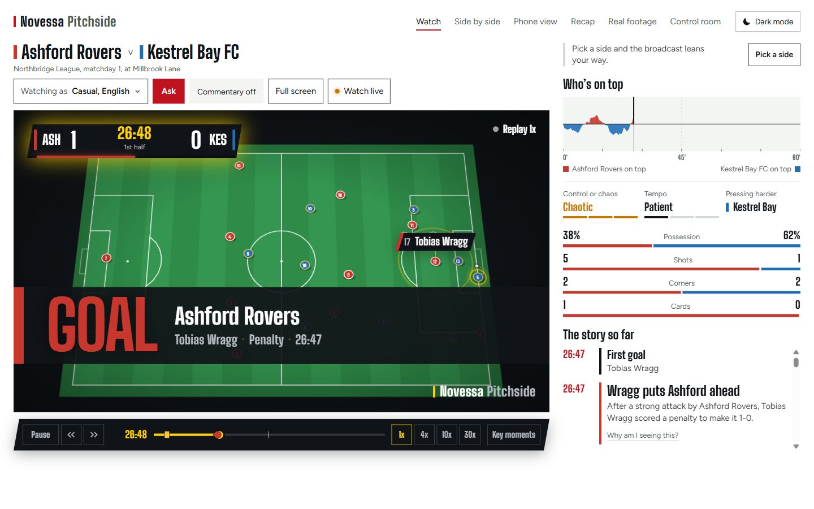
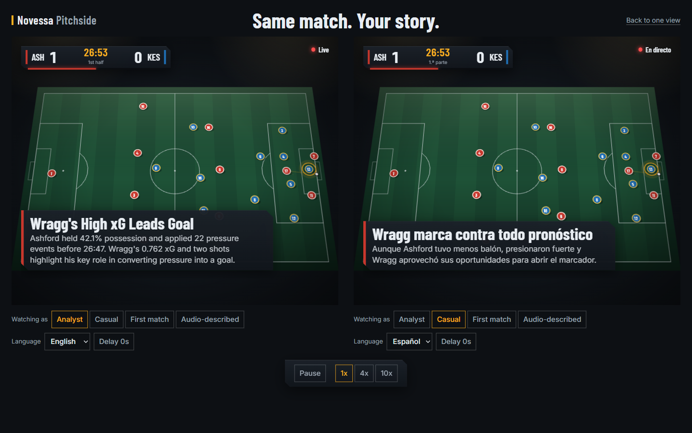
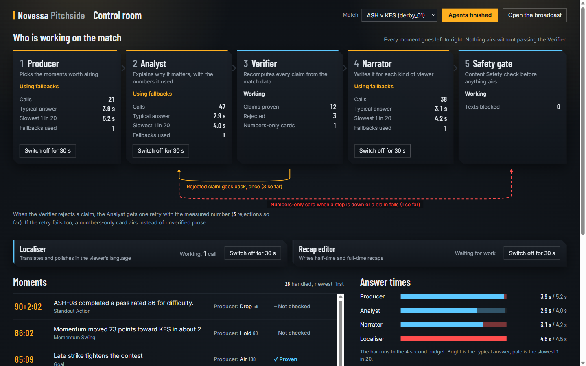
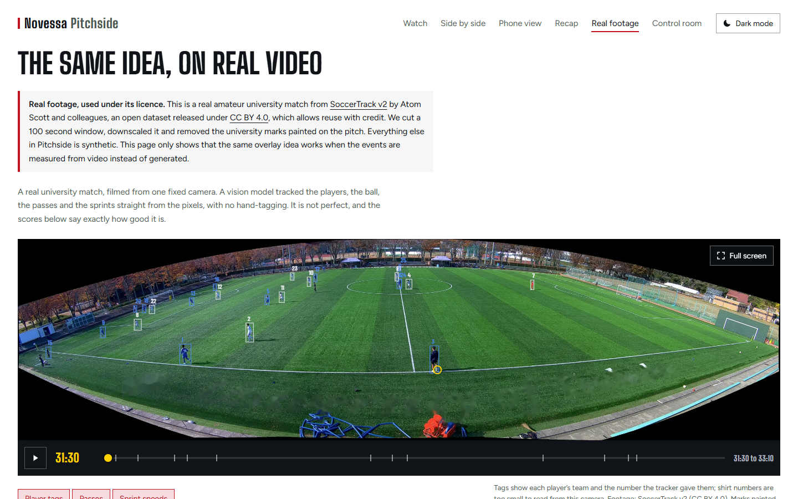

# Novessa Pitchside

**Same match. Your story.**

**Live demo:** https://ashy-pebble-0f5b51c1e.5.azurestaticapps.net (no login, runs on Azure)

Everyone watching a match gets the same broadcast. The analyst who wants pressing numbers and the mate who just wants to know why their team suddenly looks rattled see exactly the same thing. Novessa Pitchside gives each of them their own version of the game, live.

A match engine plays a full 90 minutes of football in an invented league. A stats layer turns it into momentum, pressure, control and chaos, pass difficulty, speeds and distances, in code. A team of agents on Microsoft Foundry decides which moments matter, explains why in football terms, proves every number against the stats layer before it airs, then writes it up for each viewer: their persona, their language, their club or player. The output is a timed overlay protocol, so any graphics engine could draw it.

The part we care most about is trust. A model never computes a number here, and nothing it writes reaches the screen until the Verifier has recomputed every figure. When a claim fails, the viewer gets the plain numbers instead of a nice-sounding guess. You can kill any agent mid-match from the Control Room and watch the broadcast carry on.

Built for the "Inside the Game" developer hackathon. All match data is synthetic. No real clubs, players or marks anywhere.



The same match for two viewers, second for second. The analyst gets the numbers in English. The first-timer gets the story in Spanish, with an arrow showing which way the ball is going:



The agents at work. Every moment passes the Producer, Analyst, Verifier and Safety gate, and the chaos switch on each plate shows the system recovering:



## Try it

**Fastest:** open the live demo above. Start with Watch, then Side by side, then Control room. Press `/` on the broadcast to ask the analyst a question.

**On your machine,** in about a minute. You need Python 3.12 with [`uv`](https://docs.astral.sh/uv/), and Node 22.

```bash
# terminal 1: the gateway
uv sync
AGENTS=off uv run uvicorn backend.app.main:app --port 8000

# terminal 2: the app
cd frontend
npm install
npm run dev
```

Open http://localhost:5173. The home page says what this is, shows one goal told three ways, and links to every screen. Every page has the same menu.

`AGENTS=off` runs without any Azure account: you get the pitch, the instant overlays, the stats and the recap numbers.

### With the agents on

The agents, Translator, Speech and Content Safety all live on one Foundry resource and sign in with Entra ID, so there are no keys to paste. You need the Azure CLI, signed in as someone with the **Cognitive Services User** role on that resource (see [`docs/02_AZURE_SETUP.md`](docs/02_AZURE_SETUP.md)).

1. Sign in: `az login`
2. Copy `.env.example` to `.env` and set these five, all pointing at the same resource:
   ```bash
   FOUNDRY_OPENAI_ENDPOINT=https://<resource>.cognitiveservices.azure.com/
   TRANSLATOR_ENDPOINT=https://<resource>.cognitiveservices.azure.com/
   TRANSLATOR_REGION=<region, e.g. swedencentral>
   SPEECH_REGION=<same region>
   CONTENT_SAFETY_ENDPOINT=https://<resource>.cognitiveservices.azure.com/
   ```
3. Start the gateway with that file (`PRELOAD=1` builds the three demo matches at start-up, so the first page loads fast):
   ```bash
   PRELOAD=1 uv run --env-file .env uvicorn backend.app.main:app --port 8000
   ```
   In PowerShell: `$env:PRELOAD=1; uv run --env-file .env uvicorn backend.app.main:app --port 8000`
4. Start the app as above (`cd frontend`, `npm run dev`) and open http://localhost:5173.

Check it is on: http://localhost:8000/agents/health should say `"enabled": true`, and http://localhost:8000/speech/health `"transcribe": true` (that is what shows the mic in Ask the analyst).

Places worth a look:

| Screen | Link | What to try |
|---|---|---|
| Broadcast | `/watch?match=derby_01&speed=4` | Overlays land instantly, the "why" text a moment later. Move the mouse for the timeline: drag to any minute, skip 30 s, change speed, or switch on "Key moments" to mark the goals and cards (it shows the result, so it is off by default). The menu in the corner reaches every other screen. |
| Split | `/split?match=derby_01` | Two viewers on the same second of the same match: an analyst in English and a first-timer in Spanish. Starts just before the first goal. The pitch itself differs: the analyst sees who is pressing the ball and the two simplest passes, the first-timer a big arrow showing which way the team on the ball is going and "Kestrel Bay FC tiene el balón". Change either viewer with "Viewing as". Under each pane is what that viewer has been told so far. One timeline drives both. |
| Ask the analyst | press `/` on the broadcast, or Ask on the phone view | Ask anything about the match in any of the six languages, typed or out loud (hold the mic, speak, let go). A Scout agent picks the lookups, code runs them up to your minute only (no spoilers), the Analyst answers, the Verifier checks every number. Open "How this was worked out" to see each number used. |
| Companion | `/companion?match=derby_01&speed=10` | The phone view, with its own timeline. Tap "What did I miss?" for a spoiler-safe catch-up. |
| Control Room | `/control?match=derby_01` | The agents at work, the Verifier rejecting a claim, and the chaos switch that kills an agent mid-match. |
| Recap | `/recap?match=derby_01&kind=full_time` | Half-time and full-time recaps in six languages. |
| One number | pick "Just one number" in onboarding | Choose sprint speed, shot speed, pass difficulty or distance. The broadcast keeps that number on screen and shows only that, plus goals. |
| Real footage | `/real` | The same overlays on a real amateur match, measured from video. Full screen keeps the tracking on the picture. |

## What it does

- **Synthetic league.** Eight invented clubs, 144 players, and a match engine with passes, carries, shots with xG, fouls, cards, penalties, corners, offsides, substitutions, fatigue and storylines that build over a match. Three demo matches ship in `data/matches/`, and `scripts/export_dataset.py` writes 200 matches as Parquet. See [`data/README.md`](data/README.md).
- **Deterministic stats.** Possession, momentum, pressure, control and chaos, rhythm, an explainable pass difficulty score, sprint speeds and distances. All of it is computed in code. No language model ever computes a number.
- **Instant overlays.** Name tags, speed bursts, pass difficulty, shot speed, cards, offsides and milestones come straight from the stats layer, with no model call.
- **Agents.** Nine agents and a safety gate, described below. Every number is checked by the Verifier, and a story check makes sure the right club and the right minute are named. They add the explanation, the commentary, the translation, the voice, the recap and answers to viewers' questions.
- **Personas.** Analyst, casual, first match and audio-described, and they change the picture as well as the words: pressing halos, passing options and evidence chips for the analyst; an arrow for the way play is going, no shirt numbers and short lines for a first-timer; a bigger ball for audio-described. Favourite club (a goal against your side is told more quietly), favourite player (the camera follows them, with a heatmap of where they have been), or a single metric. Six languages everywhere: English, Spanish, French, Arabic (right to left), Hindi and Portuguese. Agent text, recaps, voice, the instant overlays and the interface itself.
- **Real footage.** A vision pipeline reads a real, openly licensed amateur match, tags players, follows the ball and measures speeds, then scores itself against the dataset's own labels.

## The agents

| Agent | Job |
|---|---|
| Producer | Decides which candidate moments go on screen and how |
| Tactical Analyst | Explains why a moment matters, in football terms, from the computed numbers |
| Verifier | Recomputes every claim through the same stats code. A claim that fails goes back once, then falls back to numbers only |
| Narrator | Writes the live commentary line for each persona |
| Story Keeper | Tracks the running storylines of the match |
| Localiser | Translates with Azure AI Translator, then a model polishes it. Numbers and names are protected |
| Voice | Turns the line into speech with Azure AI Speech |
| Recap Editor | Writes half-time and full-time recaps, reachable over A2A on its own Container App |
| Ask the Analyst | A Scout picks which lookups to run, code runs them clipped to the viewer's own minute so nothing is spoiled, the Analyst answers, the Verifier checks every number and every scoreline. Typed or spoken |

Everything an agent says passes a QA step with Azure AI Content Safety before it airs, then guardrails strip links, markup and anything that reads back the system prompt. If an agent is slow, wrong or switched off, the picture is never held up: the instant overlay is already on screen and the text attaches later. The chaos switch in the Control Room shows this live.

We attacked Ask the Analyst with a fully hijacked model (prompt injection, spoilers, links, markup, prompt extraction, harmful text, off-topic). With the guardrails on, all 14 attacks were held, and the guarantee comes from code, not from the model behaving. The run is in CI on every agent change: [`docs/REDTEAM.md`](docs/REDTEAM.md).

## How it is built

```
engine ──▶ Event Hubs ──▶ gateway ──▶ state engine ──▶ instant overlays ──┐
(synthetic)                  │                             │              ├─▶ WebSocket ──▶ React + PixiJS
                             └──▶ agents (Foundry + Agent Framework) ─────┘
                                  MCP server · A2A endpoint · Cosmos DB
real footage ──▶ vision pipeline ──▶ same event schema ──▶ same overlays
```

| Microsoft technology | Where it is used |
|---|---|
| Microsoft Foundry | Two chat models: a small one for the high-volume agents, a larger one for recaps only. Foundry's evaluators (`azure-ai-evaluation`) score the output in `scripts/eval_single_vs_multi.py` |
| Microsoft Agent Framework | The Producer, Analyst, Verifier, Narrator and Gate workflow (`backend/agents/workflow.py`) |
| Azure AI Translator, Speech, Content Safety | Localiser, Voice and the QA gate, all on the Foundry resource |
| Azure Event Hubs | The live feed from engine to gateway (`backend/bus/`) |
| Azure Cosmos DB | Verified agent output per match, moment, persona and language |
| Azure Container Apps and Container Registry | Three apps from one image: the gateway and agents (`api`), our Match Intelligence MCP server (`mcp`) and the Recap Editor as its own A2A agent (`a2a`), plus a manual job that prepares the demo matches. Two API replicas stay up for judging and the others scale to zero |
| Azure Static Web Apps | The frontend, built against the live gateway |
| Azure Blob Storage | The real-footage clip. The gateway redirects to it, so the image stays small and the video is seekable |
| Azure Monitor | Application Insights and OpenTelemetry (a span on every model call: agent, model, latency, outcome), availability tests from three regions, alerts and an operations workbook |
| Azure Load Testing | 150 viewers against the live API, 32,120 requests, 0 errors ([`docs/LOAD_TEST.md`](docs/LOAD_TEST.md)) |
| Managed identity and Key Vault | Keyless access between services |
| Bicep and the Azure Developer CLI | Every resource is code (`infra/`, `azure.yaml`) |
| Azure MCP server | Used while building, to inspect and manage the resources |
| Our own MCP server and A2A endpoint | `backend/mcp_server/`, `backend/a2a/`. The match intelligence is a tool any outside agent can call, and the recap agent can be called by any other agent. Our own agents call the same stats code directly in Python, not over MCP |
| GitHub Actions and the GitHub CLI | CI (lint, types, tests, e2e and the red team) and the repo |

Decisions and their costs are in [`docs/adr/`](docs/adr/README.md). A plain-language guide to each service is in [`docs/AZURE_SERVICES.md`](docs/AZURE_SERVICES.md).

## Numbers

These are measured, not hoped for.

- **Tests:** 252 Python, 88 frontend unit, 16 browser end-to-end. Lint and types run in CI.
- **Load:** 150 simulated viewers calling the live API's endpoints for five minutes: 32,120 requests, 0 errors, p95 11 ms, scaled from 1 to 3 replicas and back ([`docs/LOAD_TEST.md`](docs/LOAD_TEST.md)).
- **Safety:** 14 of 14 red-team attacks held with guardrails on ([`docs/REDTEAM.md`](docs/REDTEAM.md)).
- **Cost:** running the agents over all three demo matches (94 moments) cost about $0.09 in model tokens. A replay of those matches costs nothing.
- **Synthetic data:** 200 simulated matches (545,639 events) measured against typical top-flight ranges. All 16 measures with a reference range are inside it or within its sampling error. Chart and table: [`docs/CALIBRATION.md`](docs/CALIBRATION.md).
- **Live feed:** 19,830 messages sent through a real Event Hub from inside Azure and read back with none lost. Publish to overlay was 140 ms at the 95th percentile at 4x replay and 115 ms at 30x, against a 150 ms budget. In memory it is 65 ms.
- **Agent text:** typically 3 to 5 seconds per step. It attaches after the instant overlay, so the picture never waits.
- **Real footage,** one 100 second window, scored against the dataset's labels (`data/real/117093_w1890/results.json`):

| Measure | Result |
|---|---|
| Players found | 71% of 11,000 labelled positions |
| Position error | median 1.0 m, 90th percentile 2.3 m |
| Player speed error | median 2.9 km/h, top speed within 3.2 km/h |

## Real footage and credits



Footage: **SoccerTrack v2 (CC BY 4.0)**, an openly licensed dataset of amateur matches on Hugging Face (`atomscott/soccertrack-v2`). It stays inside `vision/` and is used for exactly two things: showing that auto-eventing works on video, and scoring our output against its labels. It is never used to build or tune the synthetic engine.

Citation: Atom Scott, Ikuma Uchida, Kento Kuroda, Yufi Kim and Keisuke Fujii, *SoccerTrack v2: A Full-Pitch Panoramic Video Dataset for Game State Reconstruction and Ball Action Spotting*, arXiv:2508.01802, 2025. Code: github.com/AtomScott/SoccerTrack-v2.
 A university name and crest painted on the pitch are removed from the clip we show. The video file is not in this repo.

The detector is RT-DETR (Apache 2.0). We do not use Ultralytics YOLO because of its licence. Every asset is listed in [`docs/ASSET_LICENSES.md`](docs/ASSET_LICENSES.md).

## Repo map

| Path | What is in it |
|---|---|
| `engine/` | The synthetic match engine, league generator and replay clock |
| `backend/state/` | Deterministic stats and moment detection |
| `backend/agents/` | The agents, prompts and workflow |
| `backend/app/` | FastAPI gateway, WebSocket, live ingest |
| `backend/bus/` | Event bus: in memory and Event Hubs |
| `backend/mcp_server/`, `backend/a2a/` | Our MCP server and A2A endpoint |
| `vision/` | Auto-eventing from real footage |
| `frontend/` | React, Vite and TypeScript |
| `infra/` | Bicep for every Azure resource |
| `data/` | The league, three demo matches and the dataset datasheet ([`data/README.md`](data/README.md)) |
| `docs/` | Design docs, Azure setup, calibration report, decisions (`adr/`), asset licences |

Run the checks with `uv run pytest`, `uv run ruff check .`, `uv run python -m mypy .`, and in `frontend/` with `npm test`, `npm run lint` and `npm run e2e` (start the gateway with `AGENTS=off` first).

## How it answers the brief

| The brief asks for | Where it is |
|---|---|
| Ingest events as they happen | Engine to Event Hubs to gateway, keyed by match |
| Interpret into statistics and context | `backend/state/`, all deterministic |
| Explain why a moment matters | Analyst writes it, Verifier proves it, Control Room shows the trail |
| Render it beside the match | The overlay protocol, drawn on a 2D pitch and on real footage |
| Personalise | Four viewer types, favourite club or player, player focus, one number, six languages |
| Name tags, speed and distance triggers, pass quality, ball and shot speed | Instant overlays from the stats layer, under 150 ms |
| Auto-eventing from video | `vision/`, scored against ground truth |
| Control and chaos, pressure, rhythm, milestones, recaps | "Who's on top" panel, state-of-play lines, `/recap` |
| Synthetic data | A calibrated engine and a published 200-match dataset |

## Who it is for

A broadcaster makes one feed for millions of different fans. A streaming platform wants a second screen that knows who is watching. A fan who is new to the game wants it explained, and a fan who lives for the numbers wants more of them. The overlay protocol is the same for all of them: only what each viewer sees changes.

## Licence

MIT. See [`LICENSE`](LICENSE).
