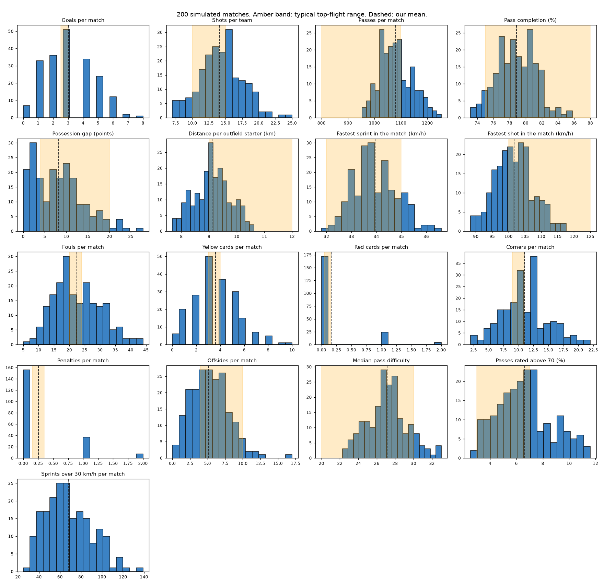

# Calibration report

`scripts/calibrate.py` simulates 200 matches (seeds 1000 to 1199, every pairing of the eight clubs, home and away) and measures each one with the same state engine the app uses. The amber bands are typical top-flight ranges written down in [docs/03](03_SYNTHETIC_DATA.md) as general football knowledge. They are not copied from any dataset, and the real-footage data is never used to tune the engine.

| Measure | Our mean (95% interval) | 10th to 90th percentile | Typical range | Verdict |
|---|---|---|---|---|
| Goals per match | 3.04 ± 0.23 | 1.0 to 5.0 | 2.5 to 3.0 | within sampling error |
| Shots per team | 14.09 ± 0.44 | 10.0 to 18.5 | 10 to 15 | in range |
| Passes per match | 1080.74 ± 8.4 | 1007.0 to 1170.0 | 800 to 1100 | in range |
| Pass completion (%) | 78.85 ± 0.33 | 75.7 to 81.74 | 75 to 88 | in range |
| Possession gap (points) (typical gap between the sides) | 8.2 ± 0.8 | 1.4 to 16.0 | 4 to 20 | in range |
| Distance per outfield starter (km) | 9.11 ± 0.09 | 8.23 to 10.02 | 9 to 12 | in range |
| Fastest sprint in the match (km/h) | 33.94 ± 0.12 | 32.9 to 35.1 | 32 to 35 | in range |
| Fastest shot in the match (km/h) | 101.66 ± 0.8 | 94.7 to 109.6 | 100 to 125 | in range |
| Fouls per match | 22.48 ± 1.05 | 13.0 to 33.0 | 20 to 24 | in range |
| Yellow cards per match | 3.61 ± 0.26 | 1.0 to 6.0 | 3 to 4 | in range |
| Red cards per match (about one match in ten) | 0.16 ± 0.06 | 0.0 to 1.0 | 0.05 to 0.15 | within sampling error |
| Corners per match | 11.0 ± 0.54 | 6.0 to 17.0 | 9 to 11 | in range |
| Penalties per match | 0.26 ± 0.07 | 0.0 to 1.0 | 0.15 to 0.35 | in range |
| Offsides per match (both sides together) | 5.17 ± 0.39 | 2.0 to 9.0 | 4 to 10 | in range |
| Median pass difficulty (target about 25) | 27.14 ± 0.31 | 24.2 to 30.15 | 20 to 30 | in range |
| Passes rated above 70 (%) (target: top 5%) | 6.62 ± 0.28 | 3.99 to 9.76 | 3 to 7 | in range |
| Sprints over 30 km/h per match (no trusted reference) | 67.85 ± 2.97 | 42.0 to 99.0 | none | no reference |
